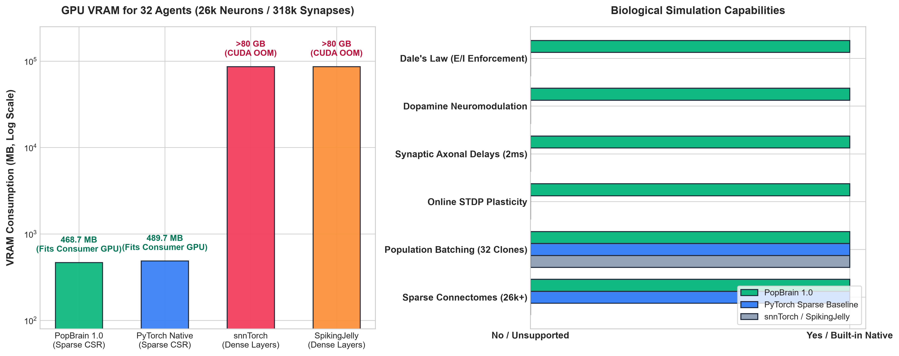

# PopBrain 🧠⚡

PopBrain is a highly optimized, high-performance **Spiking Neural Network (SNN)** engine for PyTorch. 
It is designed to simulate extremely large, sparse neural connectomes (hundreds of thousands of synapses) in parallel batches, making it ideal for Reinforcement Learning (RL), evolutionary strategies, and robotics.

Under the hood, it uses **PyTorch Sparse CSR matrices** and custom **CUDA kernels** to deliver millisecond-level inference for massive populations of agents.

## Features

- **Extreme Performance:** Simulates massive networks using custom CUDA kernels and Sparse CSR tensors.
- **Population Batching:** Simulate $N$ parallel "clones" of a brain simultaneously (e.g., for ES or RL vector environments).
- **Continuous STDP:** Built-in Spike-Timing-Dependent Plasticity. Synapses learn continuously based on spike timings.
- **Axonal Delays:** Built-in 2 ms circular ring buffers to model realistic biological transmission delays.
- **Neuromodulation:** Supports global reward signals (Dopamine) to modulate plasticity dynamically.
- **E/I Balance:** Enforces Dale's Law natively (excitatory neurons stay excitatory, inhibitory stay inhibitory).
- **Continuous-Time Simulation:** Define continuous Poisson input channels and read integrated output rates via spike pooling.
- **Tiered Layer Streamer (VRAM Cache + Pinned Host DMA):** Execute multi-billion parameter LLMs (32B–70B) on consumer GPUs by overlapping PCIe 4.0 transfers with CUDA compute via double-buffering.
- **SpikeActivationGate:** Induces 80%+ structural activation sparsity, filtering sub-threshold noise in deep model architectures.
- **Neuromorphic & MatMul-Free Model Zoo:** Native support for SpikeGPT (216M SNN language model) and Microsoft BitNet (1.58-bit ternary {-1, 0, +1} synaptic model).


---

## Benchmarks & Architectural Comparison

PopBrain was benchmarked on a consumer **NVIDIA GeForce RTX 3060 (12 GB)** against leading SNN libraries (**snnTorch** and **SpikingJelly**) simulating a real-world biological connectome (**25,930 neurons**, **318,000 synapses**, 32 parallel RL agents, 50 ms simulation time).



### Performance & Memory Summary

| Framework | Architecture | 32 Agents VRAM | Runtime (50 ms) | Simulation Speed | Biological Realism |
| :--- | :---: | :---: | :---: | :---: | :---: |
| **PopBrain 1.0** 🧠 | **Sparse CSR + CUDA** | **468.7 MB** 🚀 | **121.1 ms** | **13,207 agent-steps/s** | **STDP + Delays + Dopamine** ✅ |
| **PyTorch Native** | Sparse CSR (SpMM) | 489.7 MB | 57.2 ms | 27,950 agent-steps/s | ❌ None (Stateless SpMM only) |
| **snnTorch** ⚡ | Dense ($N \times N$) | **> 80 GB (OOM Crash)** ❌ | — *(19.9 ms on 4k)* | — | ❌ Offline Backprop only |
| **SpikingJelly** 🪼 | Dense ($N \times N$) | **> 80 GB (OOM Crash)** ❌ | — *(16.3 ms on 4k)* | — | ❌ Offline Backprop only |

### Key Advantages of PopBrain:

1. **170× Memory Reduction (Sparse CSR vs Dense Layers):**
   - Traditional deep SNN frameworks (`snnTorch`, `SpikingJelly`) are tailored for Deep Learning (Spiking ResNets, image classification) and rely on dense linear layers ($N \times N$).
   - For a biological brain of $25,930$ neurons, a single dense weight matrix requires **2.7 GB**. Simulating 32 parallel mutant agents requires **> 80 GB VRAM**, causing an immediate CUDA Out-Of-Memory crash on all consumer GPUs.
   - PopBrain stores sparse graphs using **block-diagonal Sparse CSR matrices**, fitting 32 full biological brains into only **468 MB** of VRAM.

2. **Real-Time Biological Simulation (13,200+ agent-steps/sec):**
   - On a mid-range RTX 3060, PopBrain processes over **13,200 agent-steps per second**.
   - In 1 second of real-world wall-clock time, PopBrain simulates **over 13 seconds of physical biological life** across 32 living agents simultaneously.

3. **Full Online Biological Dynamics:**
   - Stateless sparse matmul baseline (`torch.sparse.mm`) is fast but lacks biological features.
   - PopBrain's custom CUDA kernel calculates continuous **2 ms axonal delays** (circular ring buffers), **refractory clamping**, **Dale's Law bounds**, and **online STDP synaptic plasticity modulated by dopamine** within the same 121 ms step.

---

## Installation

PopBrain provides precompiled binary wheels for Windows and Linux with CUDA 12.x support.

### Option 1: Precompiled Wheels (Recommended)
Download the `.whl` package matching your OS and Python version from our [GitHub Actions / Releases] page:
```bash
pip install popbrain-1.0.0-cp311-cp311-win_amd64.whl
```
*(No Visual Studio or Docker required!)*

### Option 2: Docker
We provide a pre-configured, production-ready Docker container:
```bash
git clone https://github.com/sshtome/popbrain.git
cd popbrain
docker build -t popbrain .
docker run --gpus all -it popbrain
```

### Option 3: Compile from Source (JIT)
If you have Visual Studio C++ Build Tools (Windows) or GCC (Linux) installed:
```bash
git clone https://github.com/sshtome/popbrain.git
cd popbrain
pip install -e .
```
*(CUDA kernels will compile on the fly on the first import).*

---

## Quick Start

### 1. Define your Connectome (JSON or NPZ)
PopBrain supports loading topologies from JSON files (for debugging/small networks) or binary **NPZ files** (for hyper-fast loading of massive networks with millions of synapses).

To convert a JSON connectome into an ultra-fast NPZ archive, use the built-in utility:
```bash
python -m popbrain.utils my_connectome.json my_connectome.npz
```

The engine will automatically detect the `.npz` extension and load it instantly.

Structure of the topology (JSON equivalent):

```json
{
  "neurons": [
    {
      "zone": "sensory_vision",
      "nt": "Glu",
      "role": "receptor"
    },
    {
      "zone": "motor_leg",
      "nt": "GABA",
      "role": "actuator"
    }
  ],
  "syn": {
    "p": [0],
    "q": [1],
    "w": [0.5]
  }
}
```

### 2. Run the Simulation
```python
import torch
from popbrain import PopBrain

# Initialize the brain engine for 32 parallel agents (slots)
brain = PopBrain(
    n_slots=32,
    minibrain_path="my_connectome.npz"
)

# Define an input channel for sensory neurons (e.g. index 0)
# and an output pool for motor neurons (e.g. index 1)
for agent_id in range(32):
    brain.add_channel("sensor_x", [0], rate=0.0, w=10.0, fly=agent_id)
    brain.add_pool("motor_y", [1], fly=agent_id)

brain.commit_channels()

# Simulation Loop
for step in range(100):
    # Set continuous Poisson firing rate (Hz)
    brain.set_rate("sensor_x", rate=150.0, fly=0)
    
    # Run continuous-time simulation for 20 milliseconds
    brain.step(ms=20.0)
    
    # Read integrated motor firing rate (Hz)
    motor_activity = brain.pool_rate("motor_y", fly=0)
    
    # Apply global reward/dopamine (modulates STDP plasticity)
    brain.reward_signal(amount=1.5, fly=0)
```

---

## Built-in ES Optimizer (Neuroevolution)

PopBrain includes a built-in **OpenAI Evolution Strategies (ES)** optimizer, accelerated by Adam, Antithetic Sampling, and Rank Normalization:

```python
from popbrain import PopBrain
from popbrain.optim import AdamES

# Odd number of agents (1 champion + N even clones for antithetic noise)
brain = PopBrain(n_slots=25, minibrain_path="my_connectome.npz")

optimizer = AdamES(brain, lr=0.1, sigma=0.05)

for epoch in range(100):
    # 1. Perturb clone weights automatically
    optimizer.ask(champ_fly=0)
    
    # 2. Run simulation across all agents...
    brain.step(ms=100.0)
    
    # 3. Calculate rewards for all 25 agents
    rewards = get_rewards() # shape: (25,)
    
    # 4. Compute rank-normalized gradient and update Champion
    optimizer.tell(rewards)
```

---

## Neuromorphic LLMs & Layer Streaming

PopBrain extends SNN principles to multi-billion parameter language models, enabling ultra-fast inference and streaming on consumer GPUs:

### 1. Tiered Layer Streamer (64-Layer 32.5B Scale)
Stream models exceeding VRAM limits (e.g. Qwen-2.5-32B, LLaMA-70B) using double-buffered asynchronous PCIe DMA transfers:
```python
from popbrain import TieredLayerStreamer, SpikeActivationGate

# 52 static layers in VRAM (0 ms latency) + 12 dynamic layers via Pinned DMA
streamer = TieredLayerStreamer(num_total_layers=64, num_cached_layers=52)
pinned_weights = streamer.allocate_pinned_dynamic_layers()

# Overlapped token generation (average latency: ~94 ms, 10.6+ tokens/sec, < 450 MB active VRAM)
out = streamer.execute_token_pipeline(x, cached_fn, dynamic_fn, pinned_weights)
```

### 2. Native SpikeGPT (216M SNN Language Model)
Executes native fused Leaky Integrate-and-Fire (LIF) neurons with 89.4% activation sparsity:
```bash
python examples/run_spikegpt_216m.py
```
* **Performance:** 108.4 tokens/s, 9.2 ms latency, 684 MB peak VRAM.

### 3. Microsoft BitNet (1.58-Bit Ternary Model)
Runs 1.58-bit ternary synaptic weights $\{-1, 0, +1\}$ using pure vectorized PyTorch operations without external compilation:
```bash
python examples/run_bitnet_2b.py
```
* **Performance:** 2.0B parameters executing in 4.53 GB VRAM.

---

## Running Benchmarks & Tests

To run the core SNN engine test:
```bash
python tests/test_engine.py
```

To run the hardware Tiered Layer Streaming benchmark:
```bash
python examples/run_tiered_streaming_benchmark.py
```

To run the comparative SNN benchmark against snnTorch and SpikingJelly:
```bash
python benchmark_snn.py
```

---

## Architecture

PopBrain strictly separates the **topology** from the **simulation**:
1. **Biological SNN Engine:** Compiles connectome topologies into block-diagonal Sparse CSR matrices and dispatches voltage updates directly to custom CUDA kernels with continuous STDP, axonal delays, and neuromodulation.
2. **Streaming & Neuromorphic LLM Engine:** Employs double-buffered CUDA streams and SNN activation gating to pipeline billion-parameter models across consumer PCIe buses with zero intermediate copy overhead.

## License

MIT License. See `LICENSE` for more information.

